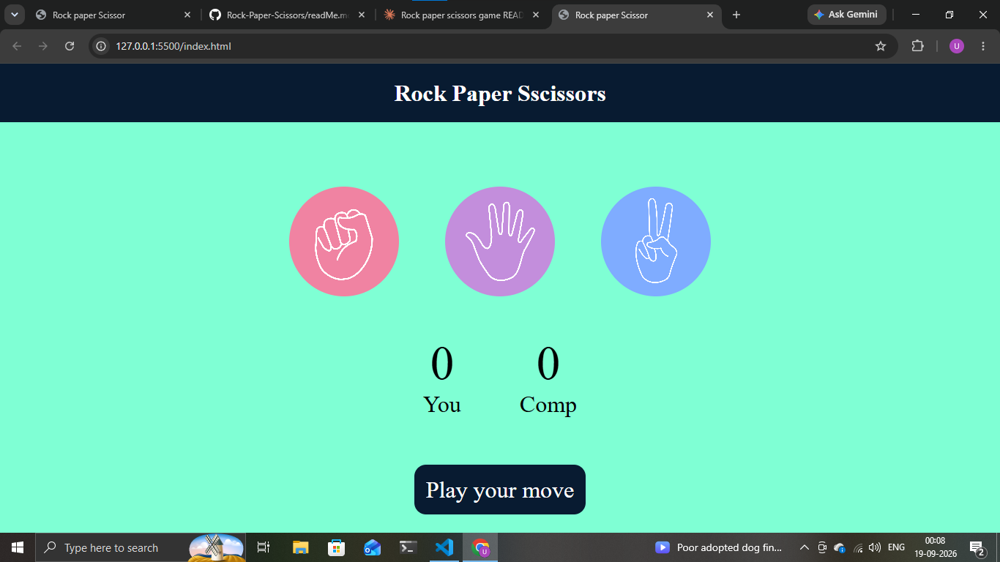

# ✊ ✋ ✌️ Rock Paper Scissors

A simple, interactive Rock Paper Scissors game built with **HTML**, **CSS**, and **JavaScript**. Play against the computer, track your score, and enjoy a clean, responsive UI — all in the browser, no frameworks or libraries required.

## 🔗 Live Demo

> Add your GitHub Pages / deployment link here once hosted:
> `https://umaima8920.github.io/Rock-Paper-Scissors/`

## 📸 Preview



*Add the screenshot file (named `screenshot.png`) to your repo's root folder so it displays here.*

## 🚀 Features

- Classic Rock, Paper, Scissors gameplay against the computer
- Clean, circular icon buttons for Rock, Paper, and Scissors
- Simple "Play your move" button to submit your choice
- Live score tracker for **You** vs **Comp**
- Eye-catching color palette — mint green background with a bold navy header bar
- Clean UI built with pure CSS (no external frameworks)
- Lightweight — built with vanilla JavaScript, no dependencies

## 🛠️ Tech Stack

| Technology | Purpose |
|------------|---------|
| HTML5      | Structure and layout of the game |
| CSS3       | Styling, layout, and responsiveness |
| JavaScript (ES6) | Game logic, event handling, and DOM manipulation |

## 📂 Project Structure

```
rock-paper-scissors/
│
├── index.html      # Main HTML file
├── style.css       # Styling for the game
├── script.js       # Game logic
└── README.md       # Project documentation
```

> Update the file names/structure above if yours differ.

## ⚙️ How It Works

1. The player picks Rock, Paper, or Scissors by clicking one of the circular icons.
2. Clicking **"Play your move"** submits the choice.
3. The computer randomly generates its own choice.
4. The two choices are compared using standard Rock-Paper-Scissors rules:
   - Rock beats Scissors
   - Scissors beats Paper
   - Paper beats Rock
5. The result is displayed, and the **You** / **Comp** score updates accordingly.

## ▶️ Getting Started

### Prerequisites
No installation or dependencies required — just a modern web browser.

### Run Locally

1. Clone the repository:
   ```bash
   git clone https://github.com/umaima8920/Rock-Paper-Scissors.git
   ```
2. Navigate into the project folder:
   ```bash
   cd Rock-Paper-Scissors
   ```
3. Open `index.html` in your browser:
   - Double-click the file, or
   - Use a live server extension (e.g., VS Code "Live Server") for auto-reload.

## 🎯 Future Improvements

- Add sound effects for wins/losses
- Add a "Best of X rounds" mode
- Add animations for choice reveal
- Add a dark mode toggle
- Store high scores using localStorage

## 🤝 Contributing

Contributions, issues, and feature requests are welcome!
Feel free to check the [issues page](https://github.com/umaima8920/Rock-Paper-Scissors/issues) or submit a pull request.


## 👤 Author

**Umaima Malik**
- GitHub: [@umaima8920](https://github.com/umaima8920)

---

⭐ If you liked this project, consider giving it a star on GitHub!